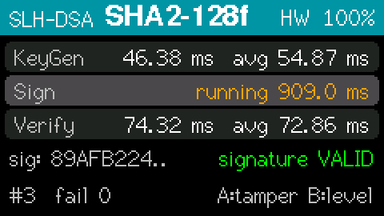

# fips205-slhdsa-esp32

Stateless hash-based post-quantum digital signatures for ESP32 using **SLH-DSA** (FIPS 205), formerly known as SPHINCS+. Supports all **12 parameter sets**: SHA2 and SHAKE, security categories 1/3/5, each in a "small" (s) and a "fast" (f) variant.

Based on [slhdsa-c](https://github.com/pq-code-package/slhdsa-c) (PQCP project) with ESP32 hardware RNG support, stack wiping of secret key material, task-watchdog-friendly long-running operations, and optional SHA hardware acceleration. It completes the set with fips203-mlkem-esp32 (ML-KEM, FIPS 203) and fips204-mldsa-esp32 (ML-DSA, FIPS 204), and follows the same structure and API style.

## Features

- **FIPS 205 compliant**: all 12 SLH-DSA parameter sets in one build, selectable per call
- **Verified against all 1,248 NIST ACVP test cases** on the host (AddressSanitizer/UBSan), and a subset on the device
- **Conservative security**: security relies only on the properties of SHA-2/SHAKE, with no lattice assumptions. A good complement to ML-DSA.
- **Hardware RNG**: uses the ESP32's random number generator (`esp_fill_random`) for key generation and hedged signing
- **Optional SHA hardware acceleration** (`SLHDSA_ESP32_HW_SHA`, off by default): the six SHA2 sets run **2.1-2.7× faster** on the ESP32's SHA accelerator, with results verified byte-identical to software (see [SHA hardware acceleration](#sha-hardware-acceleration))
- **Small RAM footprint**: under 5 KB of stack and **no heap**, so it runs directly from `setup()`/`loop()`
- **Stack wiping**: secret seeds that slhdsa-c leaves on the stack are overwritten after every key generation and signing
- **Watchdog-safe**: operations that run for minutes (the "s" sets) yield briefly every 500 ms, so they don't trigger the ESP32 task watchdog, even on single-core chips
- **Hedged and deterministic signing**, optional FIPS 205 context strings, **HashSLH-DSA** pre-hash signing (SHA-2, SHA-3, SHAKE)
- **Secret key validation** (`publicKeyFromSecretKey`)
- **NVS key storage** of the 64-128 byte secret key
- **Arduino-friendly**: C++ wrapper classes (`SLHDSA_SHA2_128f`, ...) with the same API as fips204-mldsa-esp32

## About SLH-DSA

SLH-DSA (Stateless Hash-Based Digital Signature Algorithm) was standardized by NIST as **FIPS 205** in August 2024. It is derived from **SPHINCS+**.

### How it works

SLH-DSA builds signatures from nothing but a hash function. One-time signatures (**WOTS+**, Winternitz chains of hash evaluations) are authenticated by Merkle trees (**XMSS**). These trees are stacked into a **hypertree** of `d` layers, whose single root is the public key. A message is first hashed to select a leaf. That leaf signs it with a few-time signature (**FORS**), and the hypertree authenticates the FORS key.

- **Key generation** computes the root of the top-layer XMSS tree.
- **Signing** computes one FORS signature and `d` XMSS signatures, recomputing the trees on the path (stateless: nothing has to be remembered between signatures).
- **Verification** recomputes just one authentication path, so it is fast.

The "s" (small) parameter sets use few, tall trees, which gives small signatures but slow signing. The "f" (fast) sets use many short trees, which signs faster but produces larger signatures.

Because security reduces to the hash function, SLH-DSA is the most conservative of the NIST post-quantum signatures. It is a natural choice for long-lived keys, such as firmware signing or root certificates, and as a fallback if a weakness in lattice cryptography were found.

### Parameter sets

| Parameter set | Category | Public key | Secret key | Signature |
|---------------|---------|-----------|-----------|-----------|
| SLH-DSA-SHA2-128s / SHAKE-128s | 1 (~AES-128) | 32 B | 64 B | 7,856 B |
| SLH-DSA-SHA2-128f / SHAKE-128f | 1 (~AES-128) | 32 B | 64 B | 17,088 B |
| SLH-DSA-SHA2-192s / SHAKE-192s | 3 (~AES-192) | 48 B | 96 B | 16,224 B |
| SLH-DSA-SHA2-192f / SHAKE-192f | 3 (~AES-192) | 48 B | 96 B | 35,664 B |
| SLH-DSA-SHA2-256s / SHAKE-256s | 5 (~AES-256) | 64 B | 128 B | 29,792 B |
| SLH-DSA-SHA2-256f / SHAKE-256f | 5 (~AES-256) | 64 B | 128 B | 49,856 B |

Keys are tiny, signatures are large. **On the ESP32, the SHA2 sets are 3.5-4.8× faster than the SHAKE sets** (see [Performance](#performance)). **SLH-DSA-SHA2-128f** (17 KB signature, 2.6 s to sign) is the practical default. Use an "s" set when signatures must be small and signing can take a minute or more.

## Requirements

- An ESP32-family board (ESP32, ESP32-S2, ESP32-S3, ESP32-C3, ESP32-C6, ...)
- Arduino-ESP32 core 3.x (recommended) or 2.0.x, via the Arduino IDE, `arduino-cli`, or PlatformIO
- About 5 KB of stack, plus a buffer for the signature (7.8-49.9 KB, static or heap)
- About 20 KB of flash for one parameter set, or 31 KB for all 12

## Installation

### Arduino IDE

1. Download or clone this repository.
2. Copy the `fips205-slhdsa-esp32` folder into your Arduino libraries directory:
   - Linux: `~/Arduino/libraries/`
   - macOS: `~/Documents/Arduino/libraries/`
   - Windows: `Documents\Arduino\libraries\`
3. Restart the Arduino IDE. The examples appear under *File → Examples → fips205-slhdsa-esp32*.

### arduino-cli

```bash
arduino-cli compile -b esp32:esp32:m5stack_stickc_plus2 --library /path/to/fips205-slhdsa-esp32 \
    /path/to/fips205-slhdsa-esp32/examples/slhdsa_simple
arduino-cli upload  -b esp32:esp32:m5stack_stickc_plus2 -p /dev/ttyACM0 \
    /path/to/fips205-slhdsa-esp32/examples/slhdsa_simple
```

### PlatformIO

Add to your `platformio.ini`:

```ini
lib_deps =
    symlink:///path/to/fips205-slhdsa-esp32      ; or the git URL of this repository
```

## Quick Start

```cpp
#include <Arduino.h>
#include <SLHDSA.h>

typedef SLHDSA_SHA2_128f DSA;   // any of the 12 parameter sets

static uint8_t pk[DSA::PUBLIC_KEY_SIZE];
static uint8_t sk[DSA::SECRET_KEY_SIZE];
static uint8_t sig[DSA::SIGNATURE_SIZE];   // 17 KB: keep it off the stack

void setup() {
  Serial.begin(115200);
  size_t siglen;
  const char *msg = "Hello, post-quantum world!";

  DSA::generateKeypair(pk, sk);
  DSA::sign(sig, &siglen, (const uint8_t *)msg, strlen(msg), sk);

  int result = DSA::verify(sig, siglen, (const uint8_t *)msg, strlen(msg), pk);
  Serial.println(result == 0 ? "valid" : "INVALID");

  memset(sk, 0, sizeof(sk));  // zeroize the secret key after use
}

void loop() {}
```

## API Reference

### Core operations (SLHDSA_SHA2_128s ... SLHDSA_SHAKE_256f)

All 12 classes are instances of the class template `SLHDSA<...>` and share the same API, which is also the API of `MLDSA44/65/87` in fips204-mldsa-esp32:

```cpp
#include <SLHDSA.h>

// Generate a random keypair (hardware RNG)
int DSA::generateKeypair(uint8_t *pk, uint8_t *sk);

// Derive a keypair from a 3n-byte seed SK.seed || SK.prf || PK.seed
int DSA::generateKeypairFromSeed(uint8_t *pk, uint8_t *sk, const uint8_t *seed);

// Sign (hedged, FIPS 205 slh_sign); optional context string, max 255 bytes
int DSA::sign(uint8_t *sig, size_t *siglen,
              const uint8_t *msg, size_t msglen, const uint8_t *sk,
              const uint8_t *ctx = nullptr, size_t ctxlen = 0);

// Sign, deterministic variant (same input -> same signature)
int DSA::signDeterministic(uint8_t *sig, size_t *siglen,
                           const uint8_t *msg, size_t msglen, const uint8_t *sk,
                           const uint8_t *ctx = nullptr, size_t ctxlen = 0);

// Verify (FIPS 205 slh_verify); returns 0 if valid
int DSA::verify(const uint8_t *sig, size_t siglen,
                const uint8_t *msg, size_t msglen, const uint8_t *pk,
                const uint8_t *ctx = nullptr, size_t ctxlen = 0);

// HashSLH-DSA: sign / verify with a pre-hash ("SHA2-256", "SHA3-512", "SHAKE-128", ...)
int DSA::signPreHash(uint8_t *sig, size_t *siglen, const uint8_t *msg, size_t msglen,
                     const uint8_t *sk, const char *hashAlg,
                     const uint8_t *ctx = nullptr, size_t ctxlen = 0,
                     bool deterministic = false);
int DSA::verifyPreHash(const uint8_t *sig, size_t siglen, const uint8_t *msg, size_t msglen,
                       const uint8_t *pk, const char *hashAlg,
                       const uint8_t *ctx = nullptr, size_t ctxlen = 0);

// Extract the public key from sk and validate sk (recomputes the root: one KeyGen)
int DSA::publicKeyFromSecretKey(uint8_t *pk, const uint8_t *sk);
```

Constants: `PUBLIC_KEY_SIZE` (2n), `SECRET_KEY_SIZE` (4n), `SIGNATURE_SIZE`, `SEED_SIZE` (3n), `N` (16/24/32), `MAX_CONTEXT_SIZE` (255), `SECURITY_CATEGORY` (1/3/5), `FAST` (f/s), `SHAKE` (SHAKE/SHA2), and `name()` (for example `"SLH-DSA-SHA2-128f"`). `slhdsa_esp32::MAX_SIGNATURE_SIZE` (49,856) sizes a buffer shared by all sets.

All functions return `0` on success and a negative error code on failure:

| Code | Meaning |
|------|---------|
| `SLHDSA_ERR_INVALID_SIGNATURE` (-6) | signature does not verify (also: wrong `siglen`) |
| `SLHDSA_ERR_INVALID_KEY` (-7) | secret key is inconsistent (`publicKeyFromSecretKey`) |
| `SLHDSA_ERR_INVALID_ARG` (-9) | context string longer than 255 bytes, or `NULL` with a non-zero length |
| `SLHDSA_ERR_RNG_FAIL` (-3) | random number generator failure |
| `SLHDSA_ERR_FAIL` (-1) | other failure (for example an unknown pre-hash name) |

### C API

`#include <slhdsa_esp32.h>` exposes the slhdsa-c API, where the parameter set is a pointer (`&slh_dsa_sha2_128f`, ...):

```c
int    slh_keygen_internal(uint8_t *sk, uint8_t *pk, const uint8_t *sk_seed,
                           const uint8_t *sk_prf, const uint8_t *pk_seed, const slh_param_t *prm);
size_t slh_sign(uint8_t *sig, const uint8_t *m, size_t m_sz, const uint8_t *ctx, size_t ctx_sz,
                const uint8_t *sk, const uint8_t *addrnd, const slh_param_t *prm); /* sig size or 0 */
int    slh_verify(const uint8_t *m, size_t m_sz, const uint8_t *sig, size_t sig_sz,
                  const uint8_t *ctx, size_t ctx_sz, const uint8_t *pk,
                  const slh_param_t *prm);                                        /* 1 = valid */
/* also slh_sign_internal / slh_verify_internal, hash_slh_sign / hash_slh_verify,
 * slh_pk_sz / slh_sk_sz / slh_sig_sz / slh_alg_id */

int  slhdsa_esp32_randombytes(uint8_t *out, size_t outlen);  /* hardware RNG */
void slhdsa_esp32_stack_wipe(size_t len);                      /* see below */
const slh_param_t *slhdsa_esp32_coop(const slh_param_t *prm); /* watchdog-friendly copy */
```

The C API does *not* wipe the stack. For long operations, pass `slhdsa_esp32_coop(&slh_dsa_sha2_128s)` (etc.) instead of `&slh_dsa_sha2_128s`: same results, but it yields to the idle task every 500 ms (see Important Notes). The C++ wrapper does both for you.

### SLHDSA_NVS (persistent key storage)

```cpp
#include <SLHDSA_NVS.h>

typedef SLHDSA_NVS<SLHDSA_SHA2_128f> Store;
bool Store::saveKeypair(const char *ns, const uint8_t *pk, const uint8_t *sk);
bool Store::loadKeypair(const char *ns, uint8_t *pk, uint8_t *sk, bool validate = false);
bool Store::loadPublicKey(const char *ns, uint8_t *pk);
bool Store::hasKeypair(const char *ns);
bool Store::eraseKeypair(const char *ns);
int  Store::generateAndSave(const char *ns, uint8_t *pk, uint8_t *sk);
```

- Only the 64-128 byte secret key is stored, since it contains the public key. The parameter set name is stored with it.
- NVS checksums every entry. `validate = true` additionally recomputes the public key from the seeds. That is one KeyGen: 0.1-2 s for the "f" sets, and 7-49 s for the "s" sets.

## Examples

| Example | Description |
|---------|-------------|
| [slhdsa_simple](examples/slhdsa_simple/) | Minimal keygen + sign + verify using the `SLHDSA_SHA2_128f` wrapper |
| [slhdsa_demo_arduino](examples/slhdsa_demo_arduino/) | Parameter set table, C API keygen/sign/verify with timing, tamper/context tests, hedged vs. deterministic signing, HashSLH-DSA, secret key validation |
| [slhdsa_nvs_storage](examples/slhdsa_nvs_storage/) | Persistent key storage in NVS flash (survives reboots); send `e` to erase |
| [slhdsa_test_vectors](examples/slhdsa_test_vectors/) | FIPS 205 conformance test against NIST ACVP vectors, all 12 sets and all interfaces |
| [slhdsa_hw_sha](examples/slhdsa_hw_sha/) | SHA hardware accelerator vs. software: identical keys and signatures for random inputs, and the speed-up per SHA2 set (works without enabling the option) |
| [slhdsa_benchmark](examples/slhdsa_benchmark/) | Timing and peak stack of KeyGen/Sign/Verify for all (or selected) parameter sets, CSV output |
| [m5stickc-plus2](examples/m5stickc-plus2/) | Live KeyGen/Sign/Verify timings on the M5StickC PLUS2 display; button B switches between the 12 parameter sets (requires M5Unified) |



*`m5stickc-plus2` example: framebuffer captured from the device. Same layout as the fips203-mlkem-esp32 and fips204-mldsa-esp32 demos. The cryptography runs in its own task, so the display shows the elapsed time of a running step, which can take minutes for the "s" sets. Button A runs a tamper test on the latest signature. Button B switches the parameter set: the six "f" sets come first, then the six "s" sets.*

## Performance

Measured with `examples/slhdsa_benchmark` on an **M5StickC PLUS2** (ESP32-PICO-V3-02 @ 240 MHz, Arduino-ESP32 3.3.11 / ESP-IDF 5.5.5, default `-Os`, 32-byte message). SLH-DSA has no rejection sampling, so its run time hardly varies (5 runs of each "f" set: min-max spread below 0.3%). The tables were measured before the cooperative watchdog yields were added (see Important Notes), which add about 0.5% (SHA2-128s signing: 54.46 s instead of 54.19 s).

| Parameter set | KeyGen | Sign | Verify | Signature |
|---------------|-------:|-----:|-------:|----------:|
| SLH-DSA-SHA2-128f | 111 ms | **2.60 s** | 159 ms | 17,088 B |
| SLH-DSA-SHA2-192f | 166 ms | 4.86 s | 257 ms | 35,664 B |
| SLH-DSA-SHA2-256f | 441 ms | 10.1 s | 274 ms | 49,856 B |
| SLH-DSA-SHAKE-128f | 524 ms | 12.3 s | 727 ms | 17,088 B |
| SLH-DSA-SHAKE-192f | 767 ms | 20.1 s | 1.08 s | 35,664 B |
| SLH-DSA-SHAKE-256f | 2.03 s | 41.5 s | 1.07 s | 49,856 B |
| SLH-DSA-SHA2-128s | 7.09 s | 54.2 s | **54 ms** | **7,856 B** |
| SLH-DSA-SHA2-192s | 10.6 s | 1 min 55 s | 103 ms | 16,224 B |
| SLH-DSA-SHA2-256s | 7.06 s | 1 min 49 s | 147 ms | 29,792 B |
| SLH-DSA-SHAKE-128s | 33.6 s | 4 min 16 s | 257 ms | 7,856 B |
| SLH-DSA-SHAKE-192s | 49.1 s | 7 min 31 s | 362 ms | 16,224 B |
| SLH-DSA-SHAKE-256s | 32.4 s | 6 min 42 s | 533 ms | 29,792 B |

Observations:
- **SHA2 vs. SHAKE**: the SHA2 sets are 3.5-4.8× faster than the SHAKE sets on the ESP32. slhdsa-c precomputes the SHA-256 state after the public seed, so most hash calls cost a single compression. The software Keccak permutation is comparatively expensive on the 32-bit Xtensa core.
- **"s" vs. "f"**: the "s" sets have 1.7-2.2× smaller signatures and verify faster than the matching "f" set, but signing takes 10-24× longer. They suit devices that **verify** often and sign rarely, for example checking a firmware signature at boot (54 ms with SHA2-128s), with signing done elsewhere.
- **Verification is fast for every set** (54 ms - 1.1 s), so SLH-DSA is perfectly usable on the ESP32 as a verifier.

## SHA hardware acceleration

All ESP32 chips have a SHA-2 accelerator. The library can compute the hash functions of the six **SLH-DSA-SHA2-\*** sets on it (F, H, T_l, PRF and the WOTS+ chains, which account for nearly all of the run time). The option is **off by default**.

**Enabling it**:

- PlatformIO: `build_flags = -DSLHDSA_ESP32_HW_SHA`
- arduino-cli: `--build-property "compiler.c.extra_flags=-DSLHDSA_ESP32_HW_SHA" --build-property "compiler.cpp.extra_flags=-DSLHDSA_ESP32_HW_SHA"`
- Arduino IDE (no per-sketch flags): uncomment `#define SLHDSA_ESP32_HW_SHA` in `src/slhdsa_esp32_config.h`

Nothing else changes: the `SLHDSA_SHA2_*` classes keep their API, keys and signatures, and simply run faster. `DSA::hardwareSha()` and `slhdsa_esp32_hw_sha_active()` report whether the hardware is in use. The SHAKE sets are unaffected, because the ESP32 has no SHA-3 hardware. With the option disabled, none of the hardware code is linked in.

**Speed-up** on the M5StickC PLUS2 (original ESP32 @ 240 MHz, Arduino-ESP32 3.3.11, `examples/slhdsa_hw_sha`, measured before the ~0.5% watchdog yields were added):

| Parameter set | KeyGen | Sign | Verify |
|---------------|-------:|-----:|-------:|
| SLH-DSA-SHA2-128f | 111 → **45 ms** (2.46×) | 2.60 → **1.05 s** (2.47×) | 154 → **62 ms** (2.48×) |
| SLH-DSA-SHA2-192f | 166 → **72 ms** (2.30×) | 4.92 → **1.96 s** (2.51×) | 260 → **104 ms** (2.49×) |
| SLH-DSA-SHA2-256f | 442 → **211 ms** (2.09×) | 10.2 → **4.44 s** (2.30×) | 272 → **117 ms** (2.32×) |
| SLH-DSA-SHA2-128s | 7.08 → **2.88 s** (2.46×) | 54.2 → **21.9 s** (2.48×) | 52 → **21 ms** (2.49×) |
| SLH-DSA-SHA2-192s | 10.6 → **4.62 s** (2.30×) | 116 → **44.7 s** (2.60×) | 98 → **37 ms** (2.68×) |
| SLH-DSA-SHA2-256s | 7.07 → **3.38 s** (2.09×) | 111 → **44.2 s** (2.51×) | 147 → **60 ms** (2.43×) |

With Arduino-ESP32 2.0.17 (ESP-IDF 4.4) the gain is 2.0×. Its software SHA is faster, and the hardware path reaches about the same absolute times.

**How it works**:

- The backend provides additional parameter sets `slh_dsa_sha2_*_hw` (C API) that use the same FIPS 205 parameters but hardware-backed hash functions. slhdsa-c itself is unmodified.
- slhdsa-c computes F as a single SHA-256 compression from a precomputed `PK.seed` midstate. The original ESP32 cannot load a midstate into the accelerator, so every hash is computed from the start (2 hardware blocks). That is still 2.7× faster per F (2,353 vs. 6,349 CPU cycles), using a register-level path for the dominant 2-block hashes.
- **Self-test**: before first use, hardware and software SHA-256/SHA-512 are compared on 11 message lengths, which also detects the digest byte order. If the self-test fails, everything is computed in software, so the option can never produce wrong signatures.

**Sharing the accelerator** (original ESP32):

- During an operation the library holds all SHA engines and releases them briefly every 256 hashes (about 2.5 ms).
- mbedTLS (TLS, Wi-Fi) tries the engines and transparently falls back to software meanwhile.
- `esp_sha()` and other blocking users wait at most until the next release.

Tested: while signing, two tasks on the other core computed 22,218 mbedTLS SHA-1/256/512 rounds and 22,216 `esp_sha()` calls. All results were correct, and the longest `esp_sha()` wait was 464 µs. No critical section is used, so interrupts stay enabled.

**Testing and chip support**:

| Chip | Status |
|------|--------|
| ESP32 (original) | Tested on hardware (Arduino-ESP32 3.3.11 and 2.0.17) |
| ESP32-S2 / S3 / C3 / C6 | Compile-tested only (no such board was available) |

Verification on the original ESP32:
- Keys and signatures are byte-identical to software in every randomized comparison: 51 rounds over all six SHA2 sets with the final code, 123 in total during development, deterministic and hedged, with cross-verification and tamper rejection.
- The ACVP subset passes with the option enabled (97/97).

On the S2/S3/C3/C6, the ESP-IDF 5 SHA driver is used per hash batch (the engine is held for at most 64 hashes). These chips could resume from the midstate (1 block per hash), but that optimization is not implemented yet. The C3/C6 have no SHA-512 engine, so their SHA-512 hashes stay in software. The self-test protects correctness on all of them.

## Memory usage

- **Stack**: 3.8-4.9 KB per operation for all 12 parameter sets (measured with `examples/slhdsa_benchmark`), plus the wrapper's stack wipe (it only overwrites already-free stack). No heap is used. With SHA hardware acceleration the SHA2 sets need 4.2-4.4 KB.
- **Signature buffer**: 7.8-49.9 KB, depending on the parameter set. Keep it static or on the heap, never on the 8 KB `loop()` stack.

## Conformance testing

- **Host:** all **1,248 NIST ACVP cases** pass: 120 keyGen, 624 sigGen and 504 sigVer, for every parameter set and interface.
  - sigGen covers pure, HashSLH-DSA with all 12 pre-hash functions, and internal, each deterministic and hedged.
  - sigVer includes invalid signatures and wrong-length signatures.
  - The run uses the same `acvp_runner.h` as the device, under AddressSanitizer and UndefinedBehaviorSanitizer, plus randomized round trips and negative tests for all 12 sets (2,400 checks).
- **Device:** `examples/slhdsa_test_vectors` runs a subset chosen to finish in a reasonable time. Result on the M5StickC PLUS2: **97 passed, 0 failed** in 8.5 minutes.
  - 1 keyGen case per set.
  - sigGen: 2 cases per "f" set and 1 for SHA2-128s, covering every interface and both variants.
  - sigVer: 1 valid and 1 invalid signature per set.
  - Round trips with negative tests for the "f" sets.
- Regenerate the vectors with `scripts/gen_acvp_vectors.py --download ...`. `--all --sets N` produces the full set for parameter set N.

## Important Notes

- **Signing takes time.** Even the fastest set needs 2.6 s, and the slowest needs minutes (see [Performance](#performance)). Don't sign in time-critical code paths. Run signing in its own task if the rest of the application must stay responsive, as the M5StickC example does.
- **Task watchdog**: the Arduino-ESP32 core watches the idle task of core 0 with a 5 s timeout. A key generation or signature running for seconds or minutes on that core would starve it and reset the chip. The library therefore pauses the computation for one tick (`vTaskDelay(1)`) every 500 ms, so the idle task runs and feeds the watchdog. The cost is about 0.5% run time. It works on ESP-IDF 4.4 and 5.x, and on single-core chips.
  - The C++ wrapper uses these cooperative parameter sets automatically. With the C API, use `slhdsa_esp32_coop(&slh_dsa_...)`.
  - Tasks that *you* subscribed to the watchdog (for example with `enableLoopWDT()`) are not fed during an operation.
  - An earlier design removed the idle tasks from the watchdog instead. ESP-IDF's reconfiguration has a race that occasionally logs `esp_task_wdt_reset(): task not found` (40 times in 20,000 cycles in a stress test), so it was replaced.
- **Entropy**: `esp_fill_random()` produces true random numbers only while an entropy source is running: **Wi-Fi or Bluetooth enabled**, or `bootloader_random_enable()` active. For production key generation, bring up Wi-Fi/BT first. Hedged signing stays secure with weak randomness; it then degrades to the deterministic variant.
- **Stack wiping is best-effort.** slhdsa-c keeps `SK.seed`/`SK.prf` in a context structure on the stack without zeroizing it. The wrapper therefore overwrites the stack region the operation used (5.25 KB, never more than the free stack). That wipe also shows up in `uxTaskGetStackHighWaterMark()`. Zeroize your own copies of the secret key after use.
- **Key reuse**: SLH-DSA is stateless, so a key can sign an unlimited number of messages in practice (FIPS 205 sets the limit at 2⁶⁴ signatures). There is no state to keep, unlike XMSS/LMS.

## Port details

Upstream: slhdsa-c (snapshot of 2026-08-06), portable C. The upstream sources in `src/` are unmodified. The port consists of:

| File | Purpose |
|------|---------|
| `src/slhdsa_esp32.c/.h` | Hardware RNG, stack wipe, cooperative (watchdog-friendly) copies of the parameter sets, error codes |
| `src/SLHDSA.h` | C++ wrapper. Draws the key seeds itself, because `slh_keygen()` ignores RNG failures. Rejects contexts longer than 255 bytes. Never passes `NULL` pointers to slhdsa-c (its `memcpy(dst, NULL, 0)` would be undefined behavior). |
| `src/SLHDSA_NVS.h` | NVS key storage |
| `src/slhdsa_esp32_hwsha.c` | Optional SHA-2 hardware backend (`slh_dsa_sha2_*_hw` parameter sets, self-test, engine sharing) |
| `src/slhdsa_esp32_config.h` | Build options (`SLHDSA_ESP32_HW_SHA`) |
| `scripts/gen_acvp_vectors.py` | Converts NIST ACVP JSON into `acvp_vectors.h` (binary string literals, since signatures are large) |
| `scripts/update_slhdsa_c.sh` | Re-vendors a newer slhdsa-c into `src/` |

Compiler note: unlike ML-KEM/ML-DSA, `-O2` helps the SHA2 sets by about 18% (SHA2-128f signing: 2.13 s instead of 2.60 s) but slows the SHAKE sets by about 27% (Keccak suffers from the larger code). The library therefore keeps the Arduino default `-Os`.

The SHA hardware backend uses ESP-IDF's low-level SHA functions (`sha_parallel_engine.h`, `sha_ll.h`, `sha_core.h`). Those are not a guaranteed-stable public API, which is one reason the option is off by default. The self-test guards against silent breakage by a future core update.

The slhdsa-c symbols are not namespaced (`sha2_256`, `keccak_f1600`, `slh_sign`, ...). They do not clash with the Arduino-ESP32 core, but could with other libraries that bundle their own SHA-2/SHA-3 under the same names.

Tested on hardware: M5StickC PLUS2 (ESP32-PICO-V3-02), with Arduino-ESP32 3.3.11 (arduino-cli) and with Arduino-ESP32 2.0.17 (PlatformIO `espressif32` 7.1.3). The watchdog handling was verified on both ESP-IDF branches, in software and hardware-SHA mode: a 54 s (22 s with hardware SHA) signature on core 0 runs through without a single log line, and the watchdog still fires for a later busy loop. Unlike ML-KEM/ML-DSA, SLH-DSA is about **14% faster** with the older core's GCC 8.4 (SHA2-128s signing in 46.8 s vs. 54.3 s). All examples are compile-tested on ESP32, ESP32-S2, ESP32-S3, ESP32-C3, and ESP32-C6.

## License

Licensed under the **Apache License, Version 2.0**.

The cryptographic implementation is derived from [slhdsa-c](https://github.com/pq-code-package/slhdsa-c) (PQCP project, code originally written by Markku-Juhani O. Saarinen), which is licensed under Apache-2.0 OR ISC OR MIT (see `src/LICENSE.slhdsa-c`). The upstream source files keep their original license headers. The ACVP test vectors come from NIST.

> slhdsa-c describes itself as work in progress and does not yet recommend production use. The same applies to this port.

## Links

- [FIPS 205 Standard](https://csrc.nist.gov/pubs/fips/205/final)
- [slhdsa-c (upstream)](https://github.com/pq-code-package/slhdsa-c)
- [NIST ACVP Server (test vectors)](https://github.com/usnistgov/ACVP-Server)
